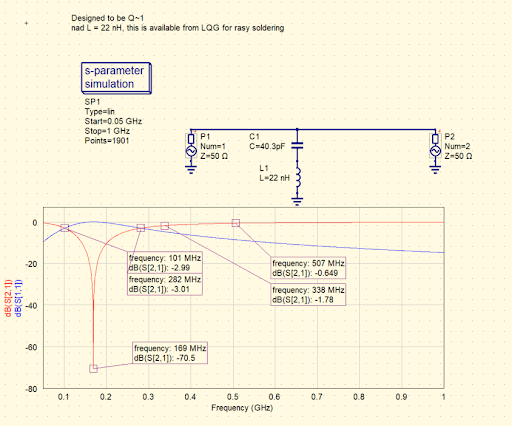
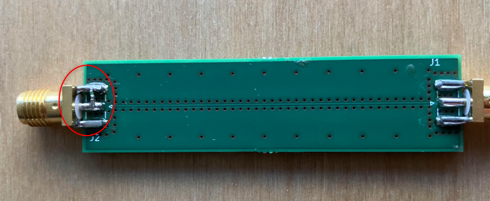
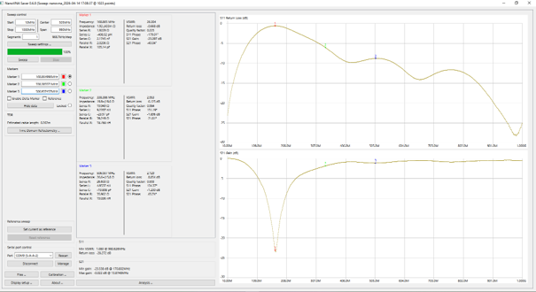

When you measure the harmonic content of a relatively high power fundamental RF signal you may find yourself measuring the noise floor of your analyser where the harmonics should be. There are cases though, where you do want to know the exact harmonic levels, one such case is when your regulatory compliance specification is just too close to the noise floor you measure but you still want to know the margin you have.

You may apply the usual tricks of tweaking the spectrum analyser configuration. Lowering the reference level will also lower the noise floor but analysers start introducing harmonics themselves (indistinguishable from the ones you want to measure) if run close to their saturation limit. This happens even before they start complaining about saturation. You may lower the resolution bandwidth (RBW) for lowering the noise floor but that has the side effect of erratic readings and sensitivity to device frequency stability. You may push these levers further on a better analyser but there is always going to be a limit.

The fundamental problem with such a measurement is that you try to fit a relatively high power signal and many low power signals in the same power measurement window (aka dynamic range). If we did not have the high power signal we would have a much easier time measuring the low power ones as analyser saturation will not play a role. Why don’t we remove the high power signal with a filter then?

There are fancy tunable cavity band reject filters (like [this one](https://www.pasternack.com/3-section-tunable-band-reject-filter-100-200-mhz-pe8734-p.aspx?srsltid=AfmBOorMLX0JW41T_qnig9qjEC4X0bk-rno8gcI7OISNRgWz3LcHv4mV)) for lab uses on the market for a few 1000 USD. However, you can build one for your own to a dedicated frequency relatively easily.

The filter topology is just a series LC to GND that presents a low impedance at its resonance and shunts the signal to GND.

One such filter centered at 169 MHz is shown below in Qucs Studio. The design goal was a Q factor of 1 on the circuit and the nearest available components were picked.

Filter implementation on a transmission line test PCB (filter is across the SMA connector):

Components: Murata 0402 LQG 22 nH multilayer inductor and Murata 0402 GJM series 39 pF + 1.3 pF capacitors (piggybacked)

Find below the performance of the filter as measured on a [nanoRFE VNA600](https://nanorfe.com/vna6000.html)

S21_169M = -23 dB

S21_338M = -1.9 dB

S21_507M = -1.2 dB

The notch is spot on, and the relative attenuation on the fundamental is > 20 dB. This is as much the dynamic range opens up by on the analyser (i.e. you can measure this much lower harmonics). If you need a deeper notch use higher quality inductors, like the Muarta LQW series. This filter did work well for me for a 169 MHz 30 dBm application and allowed me to measure accurate harmonic levels with a low end [Signal Hound SA44B](https://signalhound.com/products/usb-sa44b/?srsltid=AfmBOooTnuyy3sh2ofLAGs1velgvZbymH9ylTnkwUZ9FfhcEIPqPmpWI) analyser (with very good correlation to an Agilent PSA without the filter).

**There is one caveat**: As you can see S11 of the filter is awful at the notch. In fact, this is a fundamental behaviour of such a filter as it presents a very low impedance there (it reflects most of the power at its input at the notch center frequency). Power amplifiers do misbehave when their terminating impedances are skewed (especially to the extremes). For this reason always use an attenuator between the Tx and the filter of at least 10 dB to prevent any mismatch induced issue on the Tx output. Note that the mentioned lab filters do not have this issue; they always show a 50-ohm input impedance.

Team Z2labs
