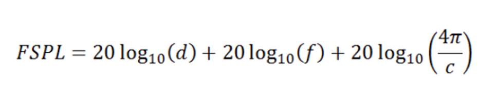
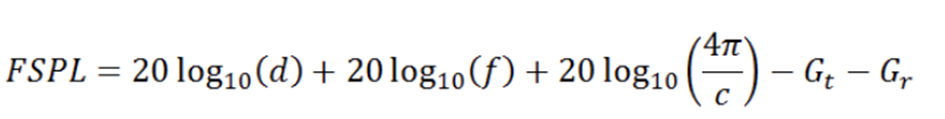

How come Free Space Path Loss has frequency dependence?

This is a chain of thought that I need to keep myself reminding about. Next time I will just visit our blog if I get confused again. 

Range calculations on RF links invariably use Free Space Path Loss as an input parameter. It describes how much attenuation an RF signal suffers between two antennas (that happen to be in the far fields of each other, i.e., the distance between them is far greater than the wavelength).

Here is a common equation for FSPL in dB terms.

The last term is a constant, the first term shows distance dependence, which is intuitive while the second term shows frequency dependence. This is not so intuitive. Why would an RF signal at a higher frequency suffer more attenuation in the same distance? Ideally, the radio waves from a spot source disperse on a sphere evenly regardless their frequency.

The answer is that RF signals at different frequencies do suffer the same attenuation over the same distance in the medium. FSPL, however, does not describe the attenuation through the medium only, it describes the ratio between available power at the receive antenna to the emitted power at the transmitter antenna.  After all, without antennas no RF energy can be converted into useful energy in a radio receiver (just as no conducted energy can be transformed into radiated RF energy at the transmitter side). Now, that antennas have entered the picture the frequency dependence starts making sense.

FSPL describes the attenuation between two unity gain antennas. (This is part of its definition). A unity gain antenna size, in turn has a dependency on frequency. It takes ever smaller antennas to achieve unity gain at ever higher frequencies. (This just comes from antenna theory). Since unity gain antennas are smaller at higher frequencies less radiated RF energy is converted by them simple because they are exposed to less area/volume in the medium (their effective area is smaller in antenna theory jargon). This is where the frequency dependence comes from.

FSPL can be extended to take the antenna gains into account at either end of the link by simply deducting them.

So, the counterintuitive dependence of frequency comes from the involvement of antenna characteristics which is not quite clear from the wording of FSPL.
