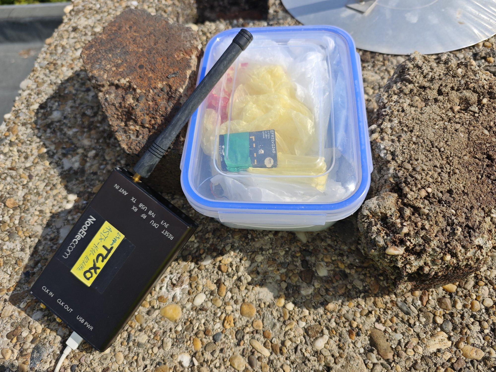
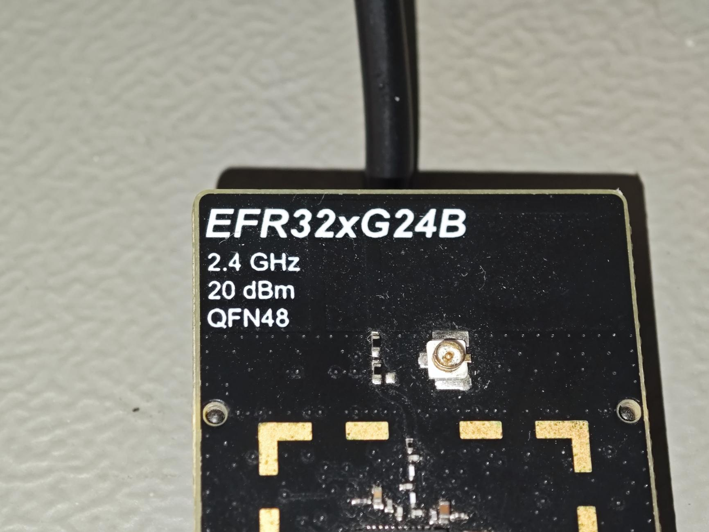
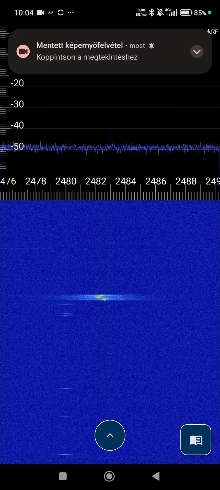
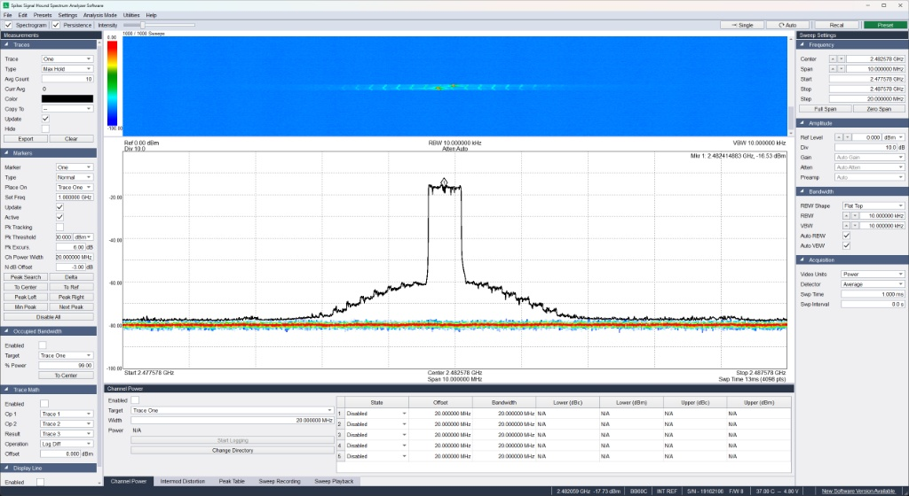
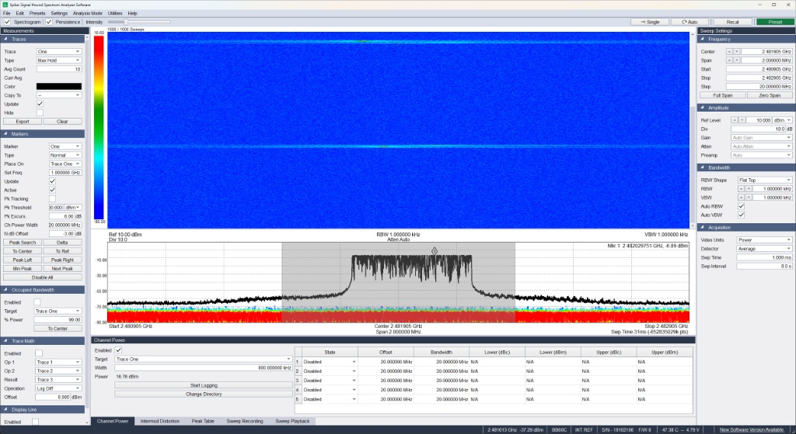
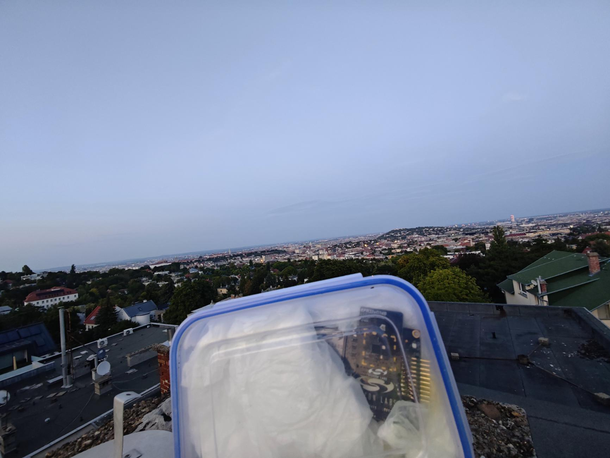
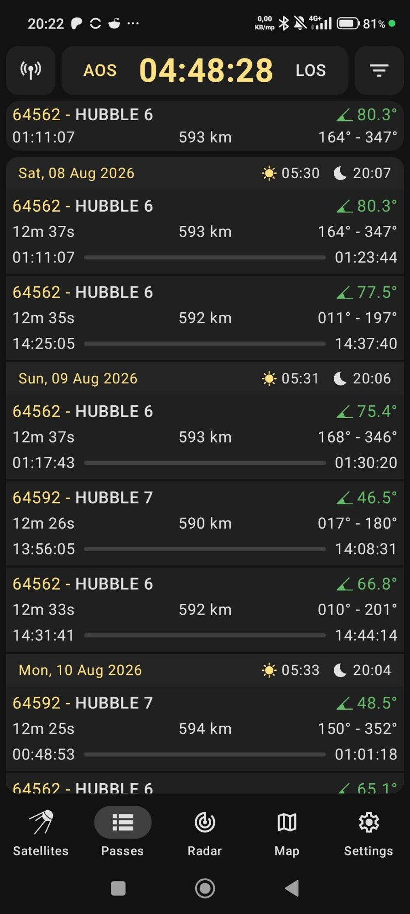
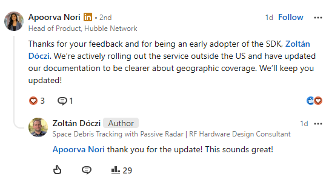
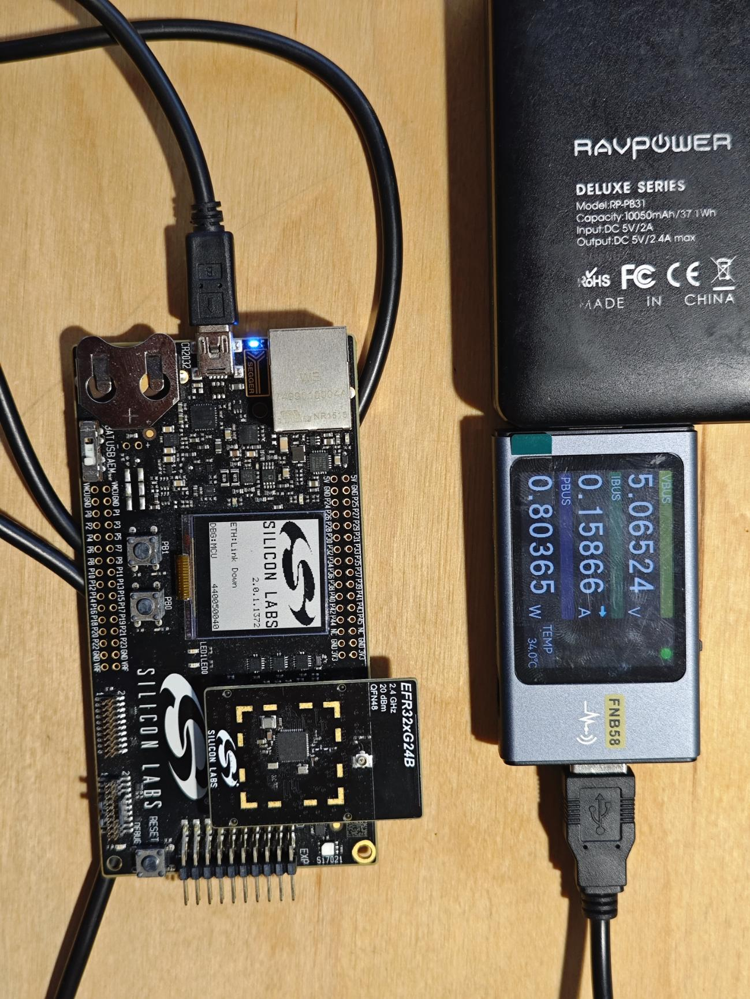
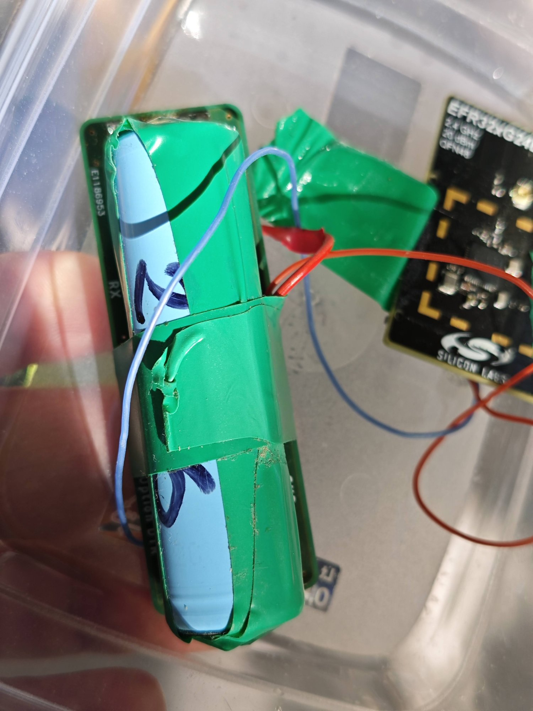

Hubble Network promises satellite connectivity from an ordinary Bluetooth SoC requiring only a firmware change and no additional radio hardware. We brought up its `sat-continuous` sample application on a +20 dBm Silicon Labs EFR32xG24 radio board, confirmed the Tx bursts near 2.482 GHz with a HackRF SDR, a Signal Hound BB60C and an ESPARGOS receiver, and left the boards on a Budapest roof for roughly eight weeks. The result? Not a single packet appeared on the Dashboard.

The radio, it turned out, wasn't the culprit. During our test, Hubble's satellite service was available only in the US, a limitation that wasn't mentioned in the onboarding documentation we followed. Hubble has since publicly confirmed this restriction and updated its documentation. In this post, we walk through the bring-up process, our measurements, and the first things we'd check if we were to run the experiment again.

## Highlights

| Item | Result | Condition |
| --- | --- | --- |
| Firmware bring-up (xG24, Zephyr) | Works, ~10.33 s send interval | `sat-continuous`, BRD4187C on WSTK |
| Carrier observed | **2.482578 GHz** | Over the air, PCB antenna, no cable |
| OTA peak at analyser | −12.4 dBm | BB60C, antenna to antenna, short distance, relative only |
| Burst spectrum (BB60C) | Narrowband, hopping-like; very likely not standard BLE GFSK | Antenna to antenna, qualitative |
| Satellite packets in Dashboard | **0** over ~8 weeks | Budapest, Sandbox account, outside the coverage region |
| Field runtime, 18650 + LDO | ~2 weeks | 2800 mAh cell, unmodified test loop |

<figure>
  <a href="roof-hackrf-and-module-box.jpg"></a>
  <figcaption>The transmitter worked from the first day of the roof test: the HackRF next to it saw every burst. The problem was further up the link. (The xG24 used its PCB antenna; the dish at the edge of the frame is unrelated.)</figcaption>
</figure>

## Context: Bluetooth to orbit

A few years ago, we worked on an ESA-funded study of a low-power IoT link via geostationary satellites, so Hubble's claim that an unmodified BLE SoC could reach orbit immediately caught our attention.

GEO and LEO satellites offer very different trade-offs. A GEO satellite remains fixed relative to the ground, providing continuous coverage of the same area and making two-way communication practical. The downside is distance: at 2.48 GHz, the free-space path loss is about 191 dB, roughly 35 dB higher than for a LEO satellite overhead at an altitude of 590 km. That extra path loss makes communication with a GEO satellite much more demanding for a low-power device.

LEO satellites, by contrast, pass much closer to the ground, reducing path loss enough to make Hubble's approach—a +20 dBm transmitter using a PCB antenna—plausible. But these satellites move across the sky, so connectivity is available only during passes. In Hubble's approach, messages are sent one-way and can take up to six hours to be delivered. This makes the technology well suited to telemetry that can tolerate delays, but less suitable for applications that require continuous connectivity or a quick response. Despite these limitations, we found the technology very interesting and wanted to give a test a go.

Hubble runs two networks. The **terrestrial** network picks up ordinary BLE advertisements through phones and gateways. The **satellite** network uses the same 2.4 GHz radio hardware, but with a dedicated waveform: according to Hubble's [regulatory page](https://hubble.com/docs/network/satellite/regulatory-compliance) it is a frequency-hopping system on 19 channels at the band edge, above 2.481 GHz, with an always-on preamble and a lower bit rate than standard BLE advertising. In other words, a standard BLE advertising sample won't reach the satellites: Hubble's satellite protocol uses its own channel plan and transmission format, rather than standard BLE advertising on channel 39.

The device side needs a supported SoC, the Hubble Device SDK, and at least +20 dBm **radiated** power. Most BLE chips output 0 to 8 dBm, so the +20 dBm xG24 radio board is one of the simplest ways in. Hubble lists the EFR32xG24 +20 dBm kit as a validated satellite platform on its [compatibility page](https://hubble.com/docs/compatibility).

The link is one-way. The device transmits and never receives an acknowledgement. Packets come down through Hubble's ground segment and are supposed to appear in the Dashboard within six hours of a pass. The only end-to-end test is to transmit and then check the Dashboard.

## Setup

| Item | Identity | Role |
| --- | --- | --- |
| Radio board | Silicon Labs BRD4187C Rev A00, EFR32MG24B220F1536IM48, +20 dBm, PCB antenna (U.FL connector path not connected) | Satellite transmitter |
| Mainboard | BRD4001A Rev A01 (WSTK) | J-Link programming, VCOM, bench power |
| Second board | ESP32-C6 SuperMini (ESP32-C6FH4), ESP-IDF 5.5.5 | Comparison transmitter |
| Receivers | HackRF One (Nooelec case, TCXO) + Android RF analyser app; Signal Hound BB60C + Spike; ESPARGOS | Local OTA verification |
| Firmware | Hubble Device SDK `samples/zephyr/sat-continuous`, Zephyr `v4.4.0-10782-gcc4eb97a7fd7` | Continuous transmit loop |
| Toolchain | Windows, Python 3.12.10, west 1.5.0, CMake 4.4.2, Zephyr SDK 1.0.1 | Build host |
| Registration | Hubble Dashboard, Sandbox org, DEVICE UPTIME counter, AES-256-CTR | Device credentials |
| Power supply | **Bench:** WSTK powered by a RAVPower RP-PB31 power bank, monitored with an FNB58 power meter. **Field:** radio board powered by an 18650 cell through an ST LDO (marking `LL33`). | Bench and rooftop power supply chain |
| Site | Flat roof, Budapest (47.5° N), open sky, board on a 20 to 30 cm non-conductive spacer |  |

We did not record the Hubble Device SDK commit hash used for the test. The SDK was checked out from the `main` branch as of mid-August 2026. This limits reproducibility and is discussed further in the Limitations section.

## How the satellite path works

```text
 EFR32xG24 (Zephyr + Hubble SDK)
   key (AES-256) + counter (DEVICE UPTIME) + 0/4/9/13-byte payload
        │  FHSS bursts, 19 ch above 2.481 GHz, +20 dBm conducted
        ▼  PCB antenna
   ~600–1100 km slant range (LEO, ~590 km altitude)
        ▼
 Hubble satellite (phased-array receiver)
        ▼  store and forward, ≤ 6 h
 Hubble cloud: decrypt, attribute to device ID  ──►  Dashboard
```

For a packet to appear in the Dashboard, the entire path must work: the device must transmit successfully, a satellite must receive the burst, and Hubble's ground segment and backend must process the packet correctly.

The device registration and transmission configuration must also agree. According to the configuration used for this test, the relevant parameters include the device key, counter source (`DEVICE UPTIME` or `UNIX_TIME`), and key size. A mismatch may prevent successful packet processing even when the RF transmission itself is correct.

This makes an empty Dashboard inherently ambiguous. It does not tell us whether a burst failed to reach a satellite, whether the satellite was listening over the test location, or whether a received packet was rejected during backend processing. Without an acknowledgement or an independent indication of satellite reception, these failure modes can look identical from the device side.

## Bring-up on Windows

The full step-by-step procedure is in the *Try it* section. These were the main issues we encountered in order:

- Python 3.14 lacked compatible wheels for `grpcio-tools` and `hidapi`. Python 3.12 resolved the issue. We reported this upstream.
- **Build tools:** Installing CMake and Ninja in the virtual environment fixed `west zephyr-export`.
- The Zephyr SDK `setup.cmd` could not find `7z` on PATH, even though the archive tool had just used it. Adding `C:\Program Files\7-Zip` to PATH fixed it.
- Unknown `HUBBLE_*` Kconfig symbols appeared because we had cloned the SDK next to an existing Zephyr workspace. Using the SDK as the west manifest (or adding it to the manifest) fixed it.
- Passing the Base64 key through PowerShell → west → CMake produced *malformed string literal … Assignment ignored*. The build went through anyway. **A key in a separate `.conf` file avoids the quoting problem.**
- The Silicon Labs radio path links against the RAIL library, which needs `west blobs fetch hal_silabs`.

Blinky built for `xg24_rb4187c` (26 400 B flash, 4 136 B RAM) and flashed through the WSTK's J-Link. The `sat-continuous` sample then booted with:

```text
*** Booting Zephyr OS build v4.4.0-10782-gcc4eb97a7fd7 ***
<inf> hubblenetwork: Hubble Device SDK initialized
      (HDCV:1.0/E:256/CS:DU/EC:128/RP:S86400/N:S/SV:0)
<inf> hubblenetwork: Hubble Satellite packet sent
<inf> hubblenetwork: Hubble Satellite packet sent
```

The fields that matter: `E:256` is AES-256, `CS:DU` is the DEVICE UPTIME counter, and `N:S` means satellite mode. Consecutive log timestamps are 10.329 s apart. *Packet sent* means only that the send call returned. It says nothing about whether a satellite received anything.

<figure>
  <a href="efr32xg24b-ufl-and-meander.jpg"></a>
  <figcaption>The whole field test ran on the on-board PCB antenna (default assembly option of the radio board). The U.FL connector is not in the RF path unless the 0 Ω selector is moved, so a cable on the U.FL alone would have done nothing.</figcaption>
</figure>

## Results: is it actually transmitting?

We checked the transmitter at four levels, and each level proves something different:

| Check | Proves | Does not prove |
| --- | --- | --- |
| Boot log with `N:S` and periodic *sent* | Firmware reaches the TX path | RF output |
| Spectrum/waterfall bursts near 2.482 GHz | RF at the right place and period | Framing, key, link margin |
| Burst spectrum | Narrowband bursts at the band edge | That Hubble can decode it |
| Packet in Dashboard | End-to-end | Reliability over many passes |

### HackRF: bursts at the band edge

With the HackRF on the roof next to the box, the Android RF analyser app (2482 MHz centre, 20 MHz span) showed a burst every ~10 s just above 2481 MHz, about 10 dB above the noise floor on the averaged trace.

<figure class="portrait">
  <a href="rf-analyzer-2482mhz-2026-08-26.jpg"></a>
  <figcaption>Every ~10 s a short burst shows up at the 2.4 GHz band edge, above the last BLE advertising channel. That is where Hubble's satellite channels are. The fainter traces to the left were not identified.</figcaption>
</figure>

### BB60C capture

To go beyond a waterfall, we pointed a Signal Hound BB60C signal analyser with a 2.4 GHz antenna at the board (antenna to antenna, short distance, no cable). The marker read −12.4 dBm peak at 2.4825 GHz in one session and −16.5 dBm in another. These are **relative** numbers: we did not calibrate antenna gains or distance, so they say nothing about EIRP. We also measured a carrier at **2.482578 GHz**.

We cannot identify the modulation from these captures. In our view it is a narrowband, frequency-hopping waveform, possibly with an FSK core, rather than standard BLE GFSK. OFDM is a weaker candidate: its peak-to-average power would cost the transmitter efficiency, which a battery-powered endpoint can ill afford.

<figure>
  <a href="bb60c-10mhz-maxhold.jpg"></a>
  <figcaption>BB60C, antenna to antenna, 10 MHz span, RBW 10 kHz, Max Hold over many bursts: the transmissions fill a flat-topped envelope roughly 1 MHz wide at 2.4825 GHz. The −16.5 dBm marker is an uncalibrated over-the-air reading.</figcaption>
</figure>
<figure>
  <a href="bb60c-2mhz-channel-power.jpg"></a>
  <figcaption>Same signal at 2 MHz span and 1 kHz RBW: the occupied band is about 800 kHz with a ragged top, which fits a signal that moves around inside the channel over successive bursts rather than a single steady carrier. Channel power is relative here, not EIRP.</figcaption>
</figure>


ESPARGOS (the ESP32-based coherent receiver array) also picked up the bursts, which gave us an independent confirmation by a third receiver. 

### The step we skipped

Hubble's [quick start guide](https://hubble.com/docs/network/satellite/quick-start) describes a more conclusive local test using an ADALM-PLUTO SDR and `pyhubblenetwork`. This setup can decode captured packets using your device key and associate them with your device ID, helping verify the transmission format and configuration independently of the satellite network.

We did not run this test. In hindsight, it is the first thing we would do next time: verify that our transmissions can be decoded locally before investigating satellite reception or backend delivery.

## The field test

We deployed the boards on the rooftop in early August and left them running until late September, with occasional interruptions for reflashing. We tested two EFR32xG24 boards, each with its own registered device key. We later added an ESP32-C6 board (a chip family supported by Hubble's ESP-IDF sample) as a comparison transmitter. All boards were positioned on a 20–30 cm plastic spacer above the roof membrane, with an unobstructed view of the sky.

<figure>
  <a href="roof-box-over-city.jpg"></a>
  <figcaption>The view of the sky was about as open as you can get in a city. At no point was the transmitter's location the limiting factor.</figcaption>
</figure>

Look4Sat with current TLEs gave plenty of high passes. HUBBLE 6 (NORAD 64562) reached 80.3° at 01:11 local on 8 August, and HUBBLE 7 (NORAD 64592) had regular passes in the 45° to 50° range. The predicted horizon-to-horizon duration was about 12.5 minutes at 590 to 594 km.

<figure class="portrait">
  <a href="look4sat-hubble6-7-passes.jpg"></a>
  <figcaption>There was no shortage of high passes over Budapest: several per day were recorded, some above 75°. Being able to see a satellite does not mean it is serving your location.</figcaption>
</figure>

After every pass the Dashboard still showed *Recent packet: Never*. Over the following weeks we checked everything on our side:

1. **Key.** We checked that the Base64 key in the build matched the registration, regenerated keys, and registered a second board separately.
2. **Counter mode.** We confirmed `CS:DU` in the boot log against DEVICE UPTIME in the Dashboard.
3. **Antenna.** We kept the PCB antenna away from the roof surface, the battery and the wiring.
4. **Passes.** We tried high-elevation passes, at night and during the day.
5. **Waiting time.** We waited more than the documented six hours before calling a pass a failure.
6. **A second transmitter.** The ESP32-C6 also produced local RF, and its packets did not appear either.

We contacted Hubble support with the hardware, SDK and configuration details. Their first reply asked which reference firmware and dev kit we were using.

### What we were missing

In late September we found out, independently and by chance, that Hubble's satellite receivers were only providing service over the US at that point. Over Europe the constellation was effectively deaf to user uplinks. Nothing in the onboarding flow or the documentation we followed (quick start, compatibility page, SDK samples) mentioned a geographic limit. Several weeks of troubleshooting the key, the antenna and the power supply were therefore aimed at a link that could not have worked from Budapest.

We wrote this up on LinkedIn. Apoorva Nori, Head of Product at Hubble Network, replied on 4 October:

> "Thanks for your feedback and for being an early adopter of the SDK, Zoltán Dóczi. We're actively rolling out the service outside the US and have updated our documentation to be clearer about geographic coverage. We'll keep you updated!"
>
> — Apoorva Nori, Hubble Network, LinkedIn, 4 October 2026

<figure>
  <a href="hubble-linkedin-coverage-update-2026-10-04.png"></a>
  <figcaption>Hubble's public reply confirms the regional limit and the documentation change. It came after the test, not before.</figcaption>
</figure>

Since then, the [transmission guidance](https://hubble.com/docs/network/satellite/transmission-guidance) lists the coverage region as **North America**. That is a useful fix, and we appreciate the quick response.

**A second blocker in the current documentation.** The updated quick start guide also states that *“Sandbox does not have Satellite access.”* Satellite access requires a *Hubble Live* organisation, but our devices were registered under Sandbox.

We don't know whether this restriction was documented when we ran our test in August, as we didn't save a copy of the documentation at the time. Regardless, under the current requirements, our setup would not have worked even within the satellite coverage area.

If you're planning to repeat this experiment, confirm both satellite coverage in your region and satellite access for your account before climbing up to the roof.

## Sanity checks

### Orbit

The HUBBLE-6 TLE from 21 September 2026 gives a mean motion of 14.937 rev/day, which is a period of 96.4 min and a semi-major axis corresponding to about **594 km** altitude. The inclination is 97.78°, a sun-synchronous orbit. This matches the 590 to 594 km that Look4Sat shows. Hubble's guidance quotes "approximately 550 km", which presumably describes the constellation in general rather than these two satellites.

Hubble's documentation gives a 3 to 5 minute useful window per pass, against 12.5 minutes horizon to horizon. That fits a receiver that only covers part of the sky: a phased array with a limited scan angle rather than an omnidirectional antenna. This is our interpretation.

### Link budget

Free-space path loss at 2.482 GHz:

$$
\mathrm{FSPL} = 20\log_{10} d + 20\log_{10} f - 147.55\ \mathrm{dB}
$$

| Elevation | Slant range | FSPL | Received power at a 0 dBi antenna for +20 dBm EIRP |
| --- | --- | --- | --- |
| 90° | 590 km | 155.8 dB | −135.8 dBm |
| 60° | 672 km | 156.9 dB | −136.9 dBm |
| 45° | 802 km | 158.4 dB | −138.4 dBm |
| 30° | 1059 km | 160.8 dB | −140.8 dBm |

A 1 MHz receiver bandwidth has a thermal noise floor of −114 dBm. A 0 dBi antenna would therefore leave the signal more than 20 dB below the noise. To close the link, the satellite needs a high-gain array (Hubble's material mentions more than 100 elements, which is roughly 20 dB of gain), processing gain from coding and repetition, and a full +20 dBm actually *radiated*. That last point is a problem for the radio board. Its small PCB antenna almost certainly has an efficiency well below 100 %, so +20 dBm *conducted* probably means less than +20 dBm *radiated*. Hubble's guidance warns that PCB and chip antennas reduce coverage and recommends a dipole. We cannot test this without coverage, but **a dipole on the U.FL path would be our first hardware change** for a supported-region test.

### Doppler

At about 7.57 km/s orbital velocity and 590 km altitude, the largest line-of-sight velocity near the horizon is about 6.9 km/s. At 2.482 GHz this gives a Doppler shift of up to about **±57 kHz**. That is not negligible: if the 19 channels share the 2.481–2.4835 GHz edge, the spacing is only about 130 kHz, so the receiver must compensate. It can, because the satellite knows its own ephemeris and the shift follows a predictable curve over the pass. In our view, Doppler combined with crystal tolerance was not a plausible reason for the missing packets, even though it was one of the first theories we considered.

### Battery life: estimate versus measurement

A first estimate assumed a 50 ms burst at 150 mA every 10 s and a 100 µA sleep current. That gives an average of about 0.85 mA, which would mean around **80 days** from a 2800 mAh 18650 cell through a low-dropout LDO. The measured runtime in the field was about **two weeks**, which means an average of roughly **7 to 8 mA**.

The difference is not mysterious. The `sat-continuous` sample is a bring-up loop, not a low-power application. The board's LED was visibly on at night. The ST LDO has a quiescent current in the hundreds of µA, and we never measured the real TX pulse or the sleep current. The bench setup drew 159 mA at 5.065 V from the power bank, but that number includes the WSTK and its debugger and says nothing about the radio itself. **Runtime estimates for this sample are meaningless until you measure the current trace.**

<figure>
  <a href="wstk-xg24-usb-meter.jpg"></a>
  <figcaption>159 mA at 5 V is what the whole WSTK draws, debugger included. Most of that current does not go to the radio, and none of it describes the radio's TX pulse.</figcaption>
</figure>

<figure>
  <a href="taped-18650-supply.jpg"></a>
  <figcaption>In the standalone field configuration, an 18650 cell feeds an ST LDO that supplies 3.3 V to the radio board. It ran for about two weeks, roughly a tenth of the estimate.</figcaption>
</figure>

### The satellites are alive

A fellow radio amateur pointed out that the Hubble satellites also have FCC-filed frequencies around 400 MHz, and that SatNOGS monitors them. HUBBLE-6 telemetry at 401.1 MHz (GMSK, 4800 Bd, AX.25) was recorded on 13 September 2026 by station 3020, Jim Hutchison, North Carolina and on 19 August 2026 by station 2178, DIYSATELLITE, Uruguay. The AX.25 address fields decode by shifting each byte right by one:

```text
8A A6 8E A6 60 62 E0  →  dest "ESGS01"
90 AA 84 84 98 6C E1  →  src  "HUBBL6"
03 F0                 →  UI frame, no layer 3
```

The rest of each frame is binary telemetry, which we did not try to interpret. These frames are the satellite's own downlink. They are **not** acknowledgements of our 2.4 GHz uplink. They do show that HUBBLE-6 was healthy and on orbit while our packets went nowhere. A nice detail: the Uruguay station received the satellite in mid-August, when nothing we sent from Budapest arrived.

## Myths we had to unlearn

During bring-up we used an AI chat assistant. Several of its answers sounded confident and were wrong, and some of them sent us after the wrong problem for days:

- **"If the key were wrong, it wouldn't compile."** It compiles. An empty key builds and runs with an all-zero placeholder, and you only get a warning at boot. A valid key from the wrong registration passes every local check. Only the backend can catch it.
- **"It's a BLE advertisement on channel 39."** It is not. The satellite mode hops over 19 channels above 2.481 GHz and uses its own framing. A BLE sniffer looking for `0x8E89BED6` will not find it.
- **"Hubble has two satellites, Hubble-1 and -2."** That information is out of date. The passes we planned around were HUBBLE 6 and HUBBLE 7, both launched in 2025 (COSPAR 2025-135).
- **"The roof detuned the antenna and 90 % of the power was reflected."** Nobody measured that. A spacer is good practice, but it was not the cause.
- **"A high pass means the satellite will hear you."** Only if the service covers your location and your account includes satellite access.

## Limitations and open questions

- **No end-to-end validation.** We never saw a packet delivered, so we cannot vouch for the complete chain. We can only say that our transmitter produced plausible RF.
- **No local decrypt.** The Pluto plus `pyhubblenetwork` test is the missing middle step.
- **No calibrated EIRP.** The over-the-air readings are relative. With a PCB antenna, it is possible that the board does not meet Hubble's requirement of at least +20 dBm *radiated*.
- **SDK commit not recorded.** Zephyr is pinned, but the Hubble SDK was `main` from mid-August.
- **Sandbox vs Live.** We do not know what the documentation said about this in August.
- **Power numbers are approximate.** We have no current trace, only the field runtime.
- **The ESP32-C6 run** produced local RF, but we did not record its PHY library setup completely.

We would repeat the test as soon as coverage reaches Europe, with a Live account, a dipole on the U.FL path, a Pluto decode before the roof, and a current probe.

## Try it

**Before anything else:** confirm with Hubble that your organisation has *Hubble Live with Satellite* (Sandbox does not include it) and that the service covers your test coordinates. When we checked on 5 October 2026, the coverage region was North America.

**1. Workspace (PowerShell, Python 3.12, Git, 7-Zip, SEGGER J-Link installed):**

```powershell
New-Item -ItemType Directory -Force -Path C:\dev\hubble-xg24
Set-Location C:\dev\hubble-xg24
py -3.12 -m venv .venv
.\.venv\Scripts\Activate.ps1
python -m pip install --upgrade pip west cmake ninja

west init -m https://github.com/HubbleNetwork/hubble-device-sdk.git .
west update
python -m pip install -r .\zephyr\scripts\requirements.txt
west zephyr-export

$env:Path += ";C:\Program Files\7-Zip"
west sdk install
west blobs fetch hal_silabs
```

**2. Prove that programming works:**

```powershell
west build -p always -b xg24_rb4187c .\zephyr\samples\basic\blinky
west flash
```

**3. Register the device** in the Dashboard with DEVICE UPTIME and AES-256-CTR. Save the Base64 key right away: it is shown only once, and the UUID shown later is the device ID, not the key.

**4. Put the key in a file instead of on the command line.** Create `samples/zephyr/sat-continuous/local-device.conf` and add it to `.git/info/exclude`:

```ini
CONFIG_SAMPLE_HUBBLE_KEY="YOUR_BASE64_KEY"
```

**5. Build, flash and check the boot log** for `E:256/CS:DU/…/N:S`:

```powershell
west build -p always -b xg24_rb4187c .\modules\lib\hubblenetwork-sdk\samples\zephyr\sat-continuous -- -DEXTRA_CONF_FILE=local-device.conf
west flash
```

**6. Decrypt locally before you go up on the roof** (ADALM-PLUTO, Docker):

```powershell
python -m pip install pyhubblenetwork
hubblenetwork sat scan --key "YOUR_BASE64_KEY"
```

**7. Payload:** the size must be exactly 0, 4, 9 or 13 bytes. For example:

```c
static const uint8_t payload[4] = { 0x01, 0x2A, 0x00, 0x00 };
err = hubble_sat_packet_get(&pkt, payload, sizeof(payload));
```

**Troubleshooting by symptom**

| Symptom | Cause in our case | Fix |
| --- | --- | --- |
| pip builds `grpcio-tools`/`hidapi` from source and fails | Python 3.14 | Python 3.12 venv |
| *CMake is not installed* | Not in the venv | `pip install cmake ninja` |
| `setup.cmd` can't find `7z` | PATH | Add the 7-Zip directory |
| Unknown `HUBBLE_*` Kconfig symbols | SDK not in the west manifest | Use the SDK as the manifest |
| *malformed string literal … Assignment ignored* | PowerShell quoting | `EXTRA_CONF_FILE` |
| RAIL library missing at link time | Blob not fetched | `west blobs fetch hal_silabs` |
| Boot warns about a placeholder key | Key empty | Supply the key, pristine build |
| RF visible, Dashboard empty | Region, account type, key or counter mismatch | Check region and account first, then decode locally |

**ESP32-C6:** use `samples/esp-idf/sat-continuous`, run `idf.py set-target esp32c6`, then `menuconfig`, then `build flash monitor`. Here the key option is called `CONFIG_HUBBLE_DEVICE_KEY`, not `CONFIG_SAMPLE_HUBBLE_KEY`. Do not overwrite `sdkconfig.defaults` with the key line alone, because that deletes the satellite and counter settings. The PHY library requirements depend on the ESP-IDF version; see the ESP-IDF integration guide. The ESP32-S3 is not a supported satellite target.

**References:** [Hubble Device SDK](https://github.com/HubbleNetwork/hubble-device-sdk) · [Satellite quick start](https://hubble.com/docs/network/satellite/quick-start) · [Transmission guidance](https://hubble.com/docs/network/satellite/transmission-guidance) · [Regulatory guidance](https://hubble.com/docs/network/satellite/regulatory-compliance) · [Chip compatibility](https://hubble.com/docs/compatibility) · [Zephyr getting started](https://docs.zephyrproject.org/latest/develop/getting_started/index.html)

---

*Updated: 5 October 2026. The documentation was rechecked after Hubble's reply; the observations above are from August–September 2026.*

*Disclosure: all hardware was our own, and Hubble Network, Silicon Labs and Espressif had no involvement in the test. An AI chat assistant was used during bring-up (see "Myths"), and this article was prepared with the help of Claude.*