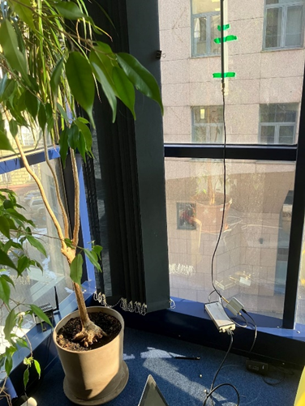
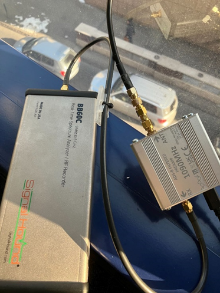
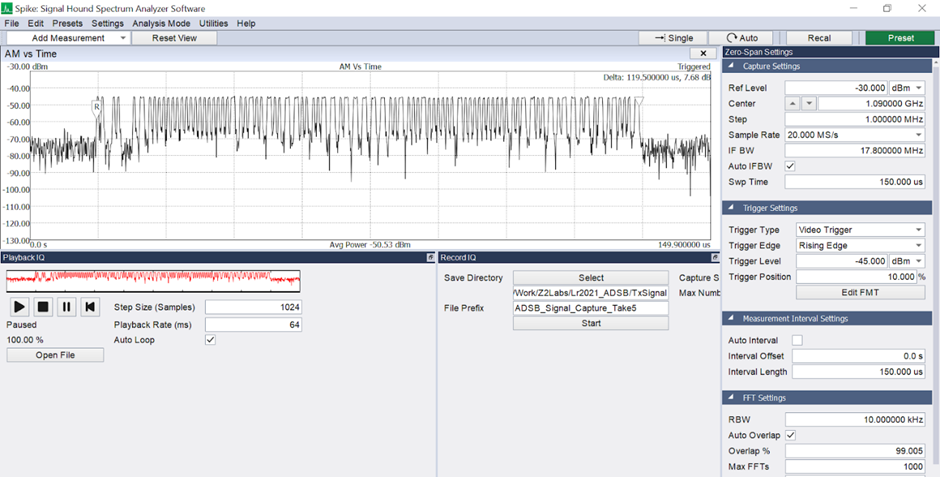
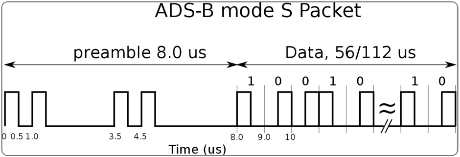
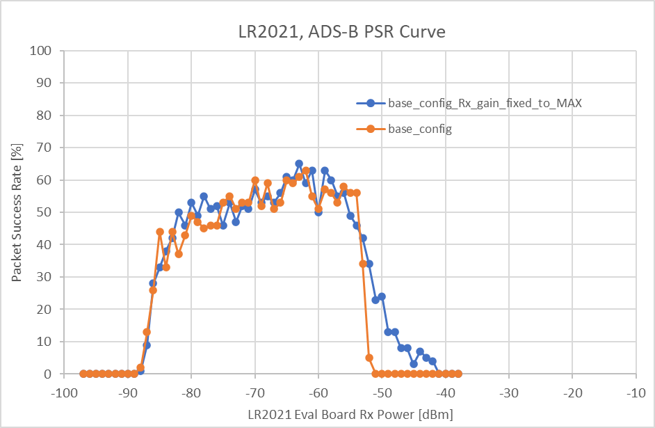
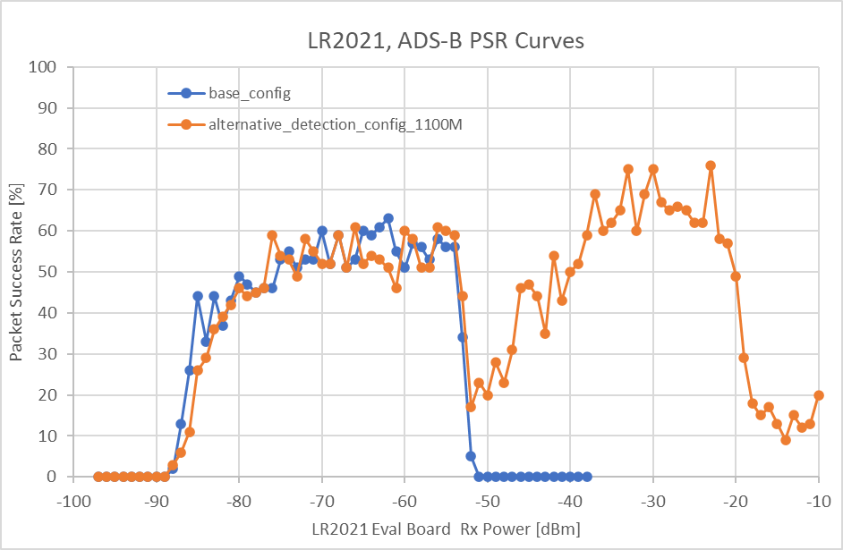
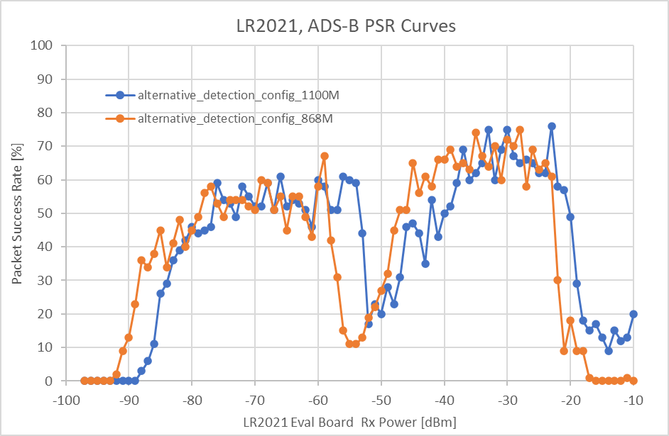
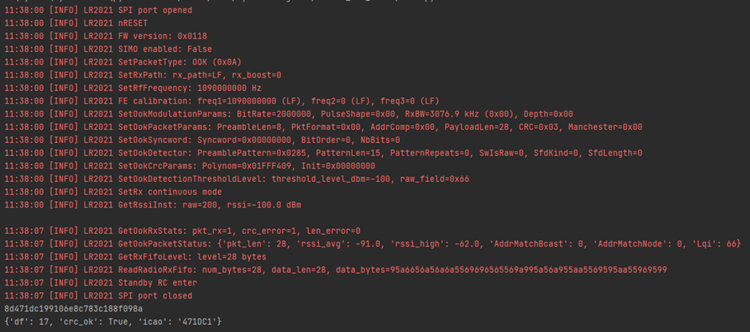
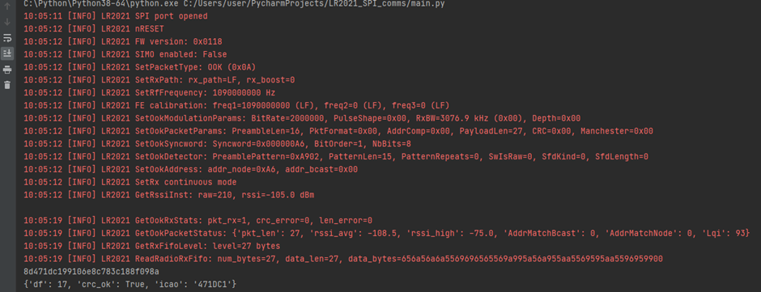

# What is ADS-B and LR2021?

ADS-B is radio protocol implemented between aircraft and ground stations to ease the burden of navigation. One message type (ADSB mode S broadcast) of this protocol transmits telemetry data from the aircraft without encryption, so anyone with a reasonable receiver can catch interesting information about planes passing over. For a good summary of ADS-B refer to this [article](https://hackmag.com/coding/ads-b-guide#:~:text=In%20total%2C%20ADS%2DB%20supports,:0%29%20%2D%20No%20Information%20Provided) at hackmag. This post shows all practical aspects and performance metrics on utilising LR2021 from Semtech for ADS-B modes S message reception.

[LR2021](https://www.semtech.com/products/wireless-rf/lora-plus/lr2021) is one of the latest LoRa TRX chips released by Semtech. The chip can cope with OOK (On Off Keying) modulation (ADS-B happens to use) and supports the ADS-B aircraft to ground frequency channel of 1090 MHz which is a promising start. Albeit vaguely, the data sheet also has some comments on how to configure the radio for ADS-B reception, this is even more promising. Since we did not know of any single chip solution for ADS-B reception all above whetted our appetite to check out what it can do.

# Signal Capture

We set out for hunting for and capturing ADS-B mode S messages in our office we could later use for testing the receiver in a controlled environment. Our setup was an 868 MHz whip antenna, an LNA specifically for the ADS-B channel and a SignalHound BB60C spectrum analyser / digitiser. 

Below is the configuration and one ADS-B hit on the analyser. The captured signals were also saved in IQ files to be reused later for receiver testing purposes (played back by SignalHound VSG60A). 

# **LR2021 configuration**

Fellow enthusiasts ([The Clams](https://github.com/TheClams)) already had a go at configuring LR2021 for ADS-B reception. Credit to them, we mostly went by their paved road. Refer to the configuration used by them [here](https://docs.rs/lr2021/latest/lr2021/ook/index.html). We are saying we mostly went by them as one of the built in LR2021 features just would not want to work for us (details in a minute), so we had to make amendments. 

This is how the beginning of the ADS-B OOK packet looks like in time. (credit to [hackmag](https://hackmag.com/coding/ads-b-guide#:~:text=In%20total%2C%20ADS%2DB%20supports,:0%29%20%2D%20No%20Information%20Provided) again)

Net bit rate is 1 Mbps. Each bit is coded by a pulse. The pulse either takes up the 1st half of the bit time (digital 1) or the second part of the bit time (digital 0). This is called Pulse Position Modulation, but you can also interpret it as Manchester coded OOK modulation, where the Manchester coded symbol rate is 2Msps.

There is a preamble (8 us, 16 symbol in Manchester coded word) and after that the useful payload starts. This is quite a challenge for a general purpose TRX chips to detect an OOK signal and adjust Rx gain, bit timing and OOK slicing level in just 16 symbols (without too many bit transitions in the preamble pattern).  So, it is quite a big thing if this works on LR2021.

Without boring you with the configuration details (you can find all the configuration flavours we created at the end of this document) there is one thing we would like to share. LR2021 does support Manchester decoding with both polarities. Oddly enough we could not make decoding work with the polarity we would need (INV MAN). This was most frustrating as the other polarity did work well. So was reception without decoding enabled. So, after quite some hair pulling, we pushed on and forgot about decoding on the chip. We would do in on the host.

This, however had another inconvenient implication: CRC checks must also be done on the host. (If Manchester decoding worked it could possibly be done on-chip.) This is not a disaster, but we surely don’t want to do the calculation too often, if it can be helped. For this reason, an LR2021 configuration is preferred where there are not too many false signal detections (like 1000s in a few second). Such a configuration also has another benefit as at each false detection LR2021 will be ‘blind’ for the duration of one packet, so during this time it would miss valid packets.

Enough said about configuration. For details on each flavour refer to the end of the document.

# **Performance curves**

The curves show packet success rate vs. power level on the evaluation board antenna connector. The test signal was one of the captured waveforms.

Configuration ‘base_config’ features: 3 MHz RxBW, Preamble detection on the full preamble pattern, No Manchester decoding

OK, is this good or bad?

- At best every second packet is lost (~50% PSR), this could still be OK (well, dependant on the application) as messages are sent often
- There is no reception above -50 dBm power level: well, this is not good; you would not pick up any planes flying close by (or sitting on the runway tarmac). This is especially bad if you would want to enhance sensitivity with an LNA in front of LR2021.

Let’s try to improve this! The reason it does not work above -50 dBm input power level is likely caused by the Rx gain settling on the chip. The Rx must adjust its front-end gain to fit the signal into its ADC’s dynamic range. This is a control process that takes time to settle which the protocol does not offer, as preamble is short.

How about using the beginning of the payload for a preamble / sync word pattern match? The ADS-B mode S broadcast message ‘df’ field is always 17. This field comes right after the preamble. So, if we are happy to pick up only broadcast messages we might as well use the ‘df’ field for signal detection (for details of the config, scroll down).

OK, this one looks better.  The Rx is now functional in the full dynamic range. The price we paid is a little bit of sensitivity degradation and the selectivity to broadcast messages only. We still see a bit of a blind patch in the middle.

What about sensitivity? Is this good or bad?  Assuming 15 dB SNR for successful demodulation, a noise figure of 5 dB, and 3 MHz bandwidth theory would give us -89 dBm.  Measurement is quite a bit shy (~ 5 dB) of that.

Let’s check how much margin there is in Rx front end matching. The LR2021 evaluation board is optimised to the 868 MHz band. Since we are in control of the test signal, we ran a test at 868M.

The whole curve shifted down by around 5 dB. If we can change the Rx frond end matching and utilise this margin at 1100 MHz than sensitivity will be pretty good, close to the theoretical calculation.

# Bottom line

If you want to capture each and every ADS-B packet with good SNR than LR2021 is probably not your choice If, however you are happy with receiving broadcast messages only than LR2021 is a viable option indeed with decent sensitivity.  An LR2021 based standalone receiver node (LR2021 drawing only 10.4 mA from a 3.3V supply) would be a nice addition to devices that fuel [https://www.flightradar24.com/](https://www.flightradar24.com/) with data.

**Stay tuned, Z2labs might just come up with a module soon.**

Disclaimer: LR2021 configurations were devised by us, and our conclusions were drawn from these configuration. This does not mean there cannot be better configurations. If someone finds something better (*hi people reading this from Semtech*) we are happy to re-test and update the results.

# Configurations

‘base_config’ configuration:

features: 3 MHz RxBW, Preamble detection on the full preamble pattern, No Manchester decoding

- * OOK threshold configuration was not used in the end
*** a variant had the Rx gain maxed out, not shown here

alternative_detection configuration

features: 3 MHz RxBW, Preamble detection on the 2nd half of the preamble pattern and the 1st half (well, 8 bits) of the ‘df’ field, No Manchester decoding

